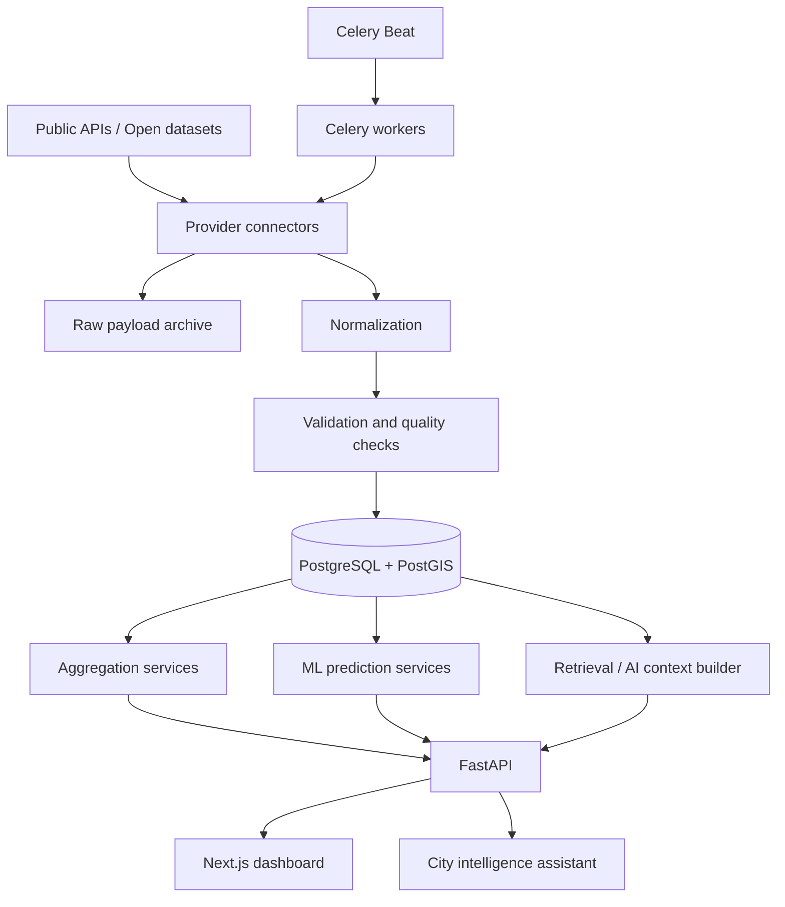

# CityPulse — Architecture

## Logical flow

## Boundaries
- `cities`: country, city, boundary and area metadata.
- `catalog`: categories, metrics, units and supported metric definitions.
- `sources`: provider metadata, terms, rate limits and source-metric mappings.
- `ingestion`: connector contracts, schedules, retries and run records.
- `observations`: immutable time-stamped source observations.
- `analytics`: aggregations and derived indicators.
- `ml`: feature preparation, training/evaluation, inference and model registry.
- `ai`: retrieval, constrained tools, summaries and citations.
- `alerts`: user rules and triggered events.

## Design rules
- Modular monolith first. Do not split into microservices without measured need.
- Keep provider-specific code behind connector interfaces.
- Store timestamps in UTC; retain source timezone where relevant.
- Store units explicitly and normalize using a documented conversion layer.
- Use PostGIS for geographic boundaries and spatial queries.
- Use Redis/Celery for scheduled and retryable background work.
- Keep raw source payloads or immutable references when legally permitted.
- Forecasts and derived metrics are separate records from observations.
